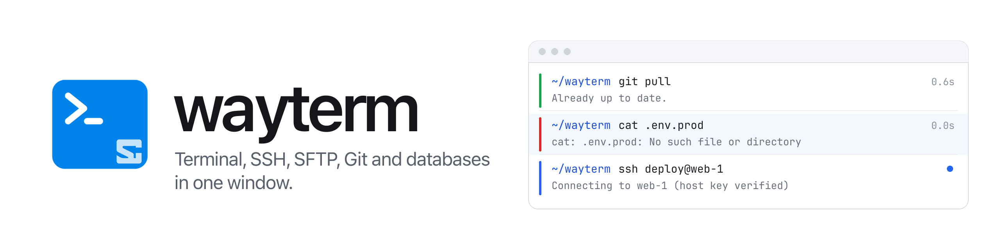
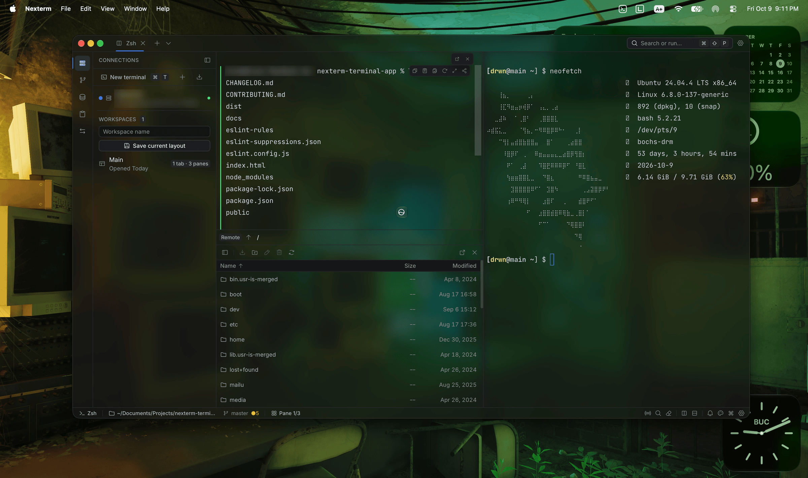
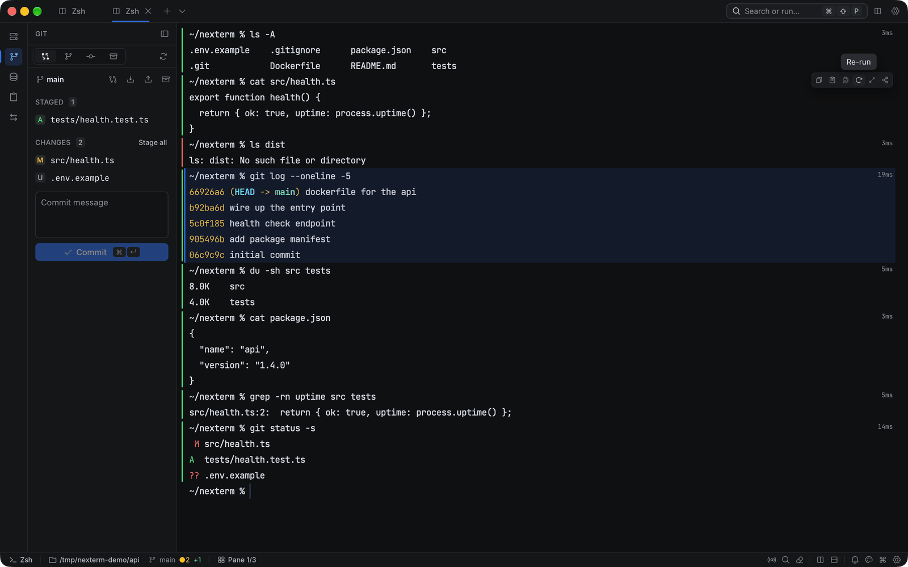
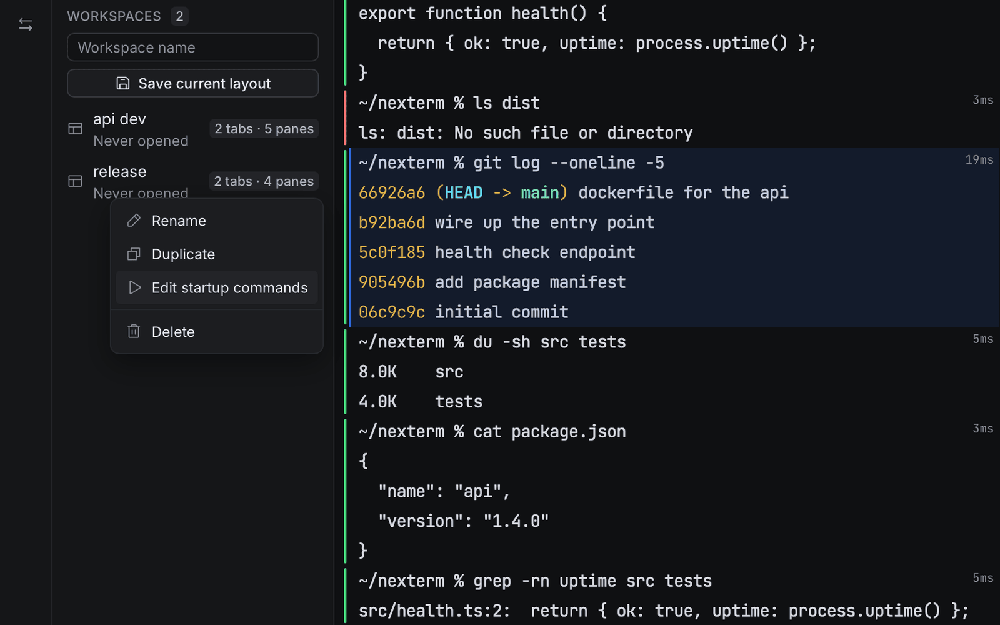

<p align="center">
  <picture>
    <source media="(prefers-color-scheme: dark)" srcset=".github/assets/brand/banner-dark.png">
    <source media="(prefers-color-scheme: light)" srcset=".github/assets/brand/banner-light.png">
    
  </picture>
</p>

<p align="center">
  A desktop terminal with saved SSH connections, an SFTP browser, a Git panel and a database client built in.<br>
  Made with Tauri, React and Rust.
</p>

<p align="center">
  <a href="https://github.com/k6w/nexterm-terminal-app/releases/latest"></a>
  <a href="https://github.com/k6w/nexterm-terminal-app/actions/workflows/ci.yml"></a>
  <a href="#download"></a>
  <a href="https://tauri.app"></a>
  <a href="https://www.rust-lang.org"></a>
  <a href="https://react.dev"></a>
</p>

<p align="center">
  <a href="#download"><b>Download</b></a> ·
  <a href="#features"><b>Features</b></a> ·
  <a href="#screenshots"><b>Screenshots</b></a> ·
  <a href="#build-from-source"><b>Build from source</b></a> ·
  <a href="CHANGELOG.md"><b>Changelog</b></a>
</p>

<br>

<p align="center">
  
  <br>
  <sub>A local shell with command blocks, an SFTP browser and an SSH session side by side, with vibrancy on (Graphite theme).</sub>
</p>

## Why Nexterm

Most working days look the same: a few local shells, a couple of servers, a repository and a database.
Nexterm keeps all of them in one window, behind one command palette and one set of shortcuts.
It uses the system webview instead of bundling a browser, so it stays small and starts quickly.

## Features

<table>
  <tr>
    <td width="33%" valign="top">
      <b>Terminal and command blocks</b><br>
      GPU rendering through xterm.js WebGL, tabs and nested splits. Every command and its output becomes a block you can select, copy, re-run or share.
    </td>
    <td width="33%" valign="top">
      <b>SSH and connections</b><br>
      Saved hosts with folders and color tags, <code>~/.ssh/config</code> import, quick connect from the palette, jump hosts and local, remote or SOCKS forwarding.
    </td>
    <td width="33%" valign="top">
      <b>Host key verification</b><br>
      Keys are checked against your <code>known_hosts</code> before connecting. A changed key shows both fingerprints and is only replaced after you confirm.
    </td>
  </tr>
  <tr>
    <td valign="top">
      <b>SFTP</b><br>
      A dual-pane browser, local on one side and remote on the other, with a sortable file table, breadcrumbs, a transfer queue and a conflict dialog.
    </td>
    <td valign="top">
      <b>Git</b><br>
      Staged and unstaged changes, a commit box, branches, history and stash, and a unified or split diff viewer. Follows the repository of the active pane.
    </td>
    <td valign="top">
      <b>Database client</b><br>
      PostgreSQL, MySQL, SQLite and MongoDB. A query editor with history, a dense results grid and CSV or JSON export.
    </td>
  </tr>
  <tr>
    <td valign="top">
      <b>Workspaces</b><br>
      Save tabs and splits, including SSH, SFTP and serial panes and per-pane startup commands, then reopen them in one step or on launch.
    </td>
    <td valign="top">
      <b>Command palette</b><br>
      Commands, connections, workspaces, snippets and themes in one list (<kbd>⌘</kbd><kbd>⇧</kbd><kbd>P</kbd>). Type <code>user@host:port</code> to connect straight away.
    </td>
    <td valign="top">
      <b>Themes and appearance</b><br>
      Four built-in themes, window vibrancy with a blur intensity slider, compact or comfortable density, and imports from Windows Terminal and iTerm2.
    </td>
  </tr>
</table>

**Keyboard first.** Every shortcut is listed and editable in Settings, with conflict warnings.

**Also included:** clipboard history, snippets with variables such as `{{host}}`, `{{cwd}}` and `{{date}}`, a drop-down scratchpad, find in terminal with a match count, serial ports, scrollback that survives restarts, a system tray icon, launch on startup and signed automatic updates.

## Screenshots

<table>
  <tr>
    <td width="50%"></td>
    <td width="50%"></td>
  </tr>
  <tr>
    <td align="center"><sub>Command blocks and their hover toolbar</sub></td>
    <td align="center"><sub>Saved workspaces</sub></td>
  </tr>
  <tr>
    <td></td>
    <td></td>
  </tr>
  <tr>
    <td align="center"><sub>The command palette</sub></td>
    <td align="center"><sub>Quick connect from the palette</sub></td>
  </tr>
  <tr>
    <td></td>
    <td></td>
  </tr>
  <tr>
    <td align="center"><sub>Saving an SSH connection</sub></td>
    <td align="center"><sub>Drag a tab onto a pane to split it</sub></td>
  </tr>
  <tr>
    <td></td>
    <td></td>
  </tr>
  <tr>
    <td align="center"><sub>Git changes and the commit box</sub></td>
    <td align="center"><sub>The diff viewer</sub></td>
  </tr>
  <tr>
    <td></td>
    <td></td>
  </tr>
  <tr>
    <td align="center"><sub>Querying a SQLite file</sub></td>
    <td align="center"><sub>Settings: Appearance</sub></td>
  </tr>
</table>

## Download

Get the latest build for your system from the [releases page](https://github.com/k6w/nexterm-terminal-app/releases/latest).

| Platform | File |
| --- | --- |
| macOS (Apple silicon) | `Nexterm_<version>_aarch64.dmg` |
| macOS (Intel) | `Nexterm_<version>_x64.dmg` |
| Windows | `.msi`, or the `-setup.exe` installer |
| Linux | `.AppImage`, `.deb` or `.rpm` |

> [!NOTE]
> The macOS builds are not signed or notarized yet, so Gatekeeper blocks the first launch. Right-click Nexterm in Applications, choose **Open**, then confirm. After that, Nexterm updates itself; updates are signed and checked against a public key built into the app.

There is no Homebrew tap or other package manager listing yet.

## Keyboard shortcuts

| Action | macOS | Windows / Linux |
| --- | --- | --- |
| Command palette | <kbd>⌘</kbd><kbd>⇧</kbd><kbd>P</kbd> | <kbd>Ctrl</kbd><kbd>Shift</kbd><kbd>P</kbd> |
| New tab | <kbd>⌘</kbd><kbd>T</kbd> | <kbd>Ctrl</kbd><kbd>T</kbd> |
| Close tab | <kbd>⌘</kbd><kbd>W</kbd> | <kbd>Ctrl</kbd><kbd>W</kbd> |
| Next / previous tab | <kbd>⌘</kbd><kbd>⇥</kbd> / <kbd>⌘</kbd><kbd>⇧</kbd><kbd>⇥</kbd> | <kbd>Ctrl</kbd><kbd>Tab</kbd> / <kbd>Ctrl</kbd><kbd>Shift</kbd><kbd>Tab</kbd> |
| Go to tab 1 to 9 | <kbd>⌘</kbd><kbd>1</kbd> … <kbd>⌘</kbd><kbd>9</kbd> | <kbd>Ctrl</kbd><kbd>1</kbd> … <kbd>Ctrl</kbd><kbd>9</kbd> |
| Split side by side | <kbd>⌘</kbd><kbd>⇧</kbd><kbd>D</kbd> | <kbd>Ctrl</kbd><kbd>Shift</kbd><kbd>D</kbd> |
| Split top and bottom | <kbd>⌘</kbd><kbd>⇧</kbd><kbd>E</kbd> | <kbd>Ctrl</kbd><kbd>Shift</kbd><kbd>E</kbd> |
| Close pane | <kbd>⌘</kbd><kbd>⇧</kbd><kbd>W</kbd> | <kbd>Ctrl</kbd><kbd>Shift</kbd><kbd>W</kbd> |
| Zoom pane | <kbd>⌘</kbd><kbd>⇧</kbd><kbd>↩</kbd> | <kbd>Ctrl</kbd><kbd>Shift</kbd><kbd>Enter</kbd> |
| Move pane to its own tab | <kbd>⌘</kbd><kbd>⇧</kbd><kbd>T</kbd> | <kbd>Ctrl</kbd><kbd>Shift</kbd><kbd>T</kbd> |
| Focus next / previous pane | <kbd>⌥</kbd><kbd>]</kbd> / <kbd>⌥</kbd><kbd>[</kbd> | <kbd>Alt</kbd><kbd>]</kbd> / <kbd>Alt</kbd><kbd>[</kbd> |
| Find in terminal | <kbd>⌘</kbd><kbd>F</kbd> | <kbd>Ctrl</kbd><kbd>F</kbd> |
| Previous / next command block | <kbd>⌘</kbd><kbd>↑</kbd> / <kbd>⌘</kbd><kbd>↓</kbd> | <kbd>Ctrl</kbd><kbd>Shift</kbd><kbd>↑</kbd> / <kbd>Ctrl</kbd><kbd>Shift</kbd><kbd>↓</kbd> |
| Extend block selection | <kbd>⌘</kbd><kbd>⇧</kbd><kbd>↑</kbd> / <kbd>⌘</kbd><kbd>⇧</kbd><kbd>↓</kbd> | <kbd>Ctrl</kbd><kbd>Alt</kbd><kbd>Shift</kbd><kbd>↑</kbd> / <kbd>↓</kbd> |
| Copy selected block output | <kbd>⌘</kbd><kbd>C</kbd> | <kbd>Ctrl</kbd><kbd>Shift</kbd><kbd>C</kbd> |
| Clear block selection | <kbd>Esc</kbd> | <kbd>Esc</kbd> |
| Clipboard history | <kbd>⌘</kbd><kbd>⇧</kbd><kbd>V</kbd> | <kbd>Ctrl</kbd><kbd>Shift</kbd><kbd>V</kbd> |
| Scratchpad | <kbd>⌥</kbd><kbd>`</kbd> | <kbd>Alt</kbd><kbd>`</kbd> |
| Toggle sidebar | <kbd>⌘</kbd><kbd>B</kbd> | <kbd>Ctrl</kbd><kbd>B</kbd> |
| Settings | <kbd>⌘</kbd><kbd>,</kbd> | <kbd>Ctrl</kbd><kbd>,</kbd> |

On Windows and Linux, terminal copy and paste are <kbd>Ctrl</kbd><kbd>Shift</kbd><kbd>C</kbd> and <kbd>Ctrl</kbd><kbd>Shift</kbd><kbd>V</kbd>; on macOS the usual <kbd>⌘</kbd><kbd>C</kbd> and <kbd>⌘</kbd><kbd>V</kbd> work. Copy still copies selected text when there is some. Every binding can be changed in **Settings → Keybindings**.

## Command blocks

Each command you run and its output become a block. A gutter on the left shows whether the command is running, succeeded or failed, and the prompt line shows how long it took.

- Click the gutter to select a block, <kbd>Shift</kbd>-click to select a range, or move between blocks from the keyboard.
- Hover a block to copy the command, the output or both, re-run it, open the output in a viewer, or copy it as text to share. The right-click menu has the same actions.
- Re-run only types at an idle prompt. Anything Nexterm can't vouch for is pasted for you to review instead of being run.
- Block shortcuts only apply at the shell prompt, so Vim, tmux and other full-screen apps keep their keys.

Blocks run on shell integration for zsh, bash and fish. Nexterm sets it up for local shells automatically without touching your dotfiles, and signs the prompt and exit marks with a per-session secret so program output can't fake a block.

**On remote hosts**, open **Settings → Terminal → Shell integration → Remote hosts**, pick your shell and paste the snippet into the server's rc file (for example `~/.bashrc` or `~/.zshrc`). Shell integration and command blocks are on by default, and both can be turned off on the same page.

## Themes

Nexterm ships four themes. Each covers both the app and the terminal palette, and each passes WCAG AA contrast, which a test enforces.

<table>
  <tr>
    <td width="50%"></td>
    <td width="50%"></td>
  </tr>
  <tr>
    <td align="center"><sub><b>Graphite</b>, the default</sub></td>
    <td align="center"><sub><b>Frost</b></sub></td>
  </tr>
  <tr>
    <td></td>
    <td></td>
  </tr>
  <tr>
    <td align="center"><sub><b>Ember</b></sub></td>
    <td align="center"><sub><b>Paper</b>, the light theme</sub></td>
  </tr>
</table>

To use your own, go to **Settings → Appearance → Import theme…** and pick a file. Nexterm reads its own `.json` format, Windows Terminal color schemes (`.json`) and iTerm2 `.itermcolors`. The quickest start is to copy `src/themes/graphite.json` (or `paper.json` for a light theme), change the `id` and `name`, and edit the colors. [THEMES.md](THEMES.md) lists every token and the rules a theme has to follow.

## Security and privacy

- **Host keys.** Before an SSH or SFTP session starts, the server key is checked against your own `~/.ssh/known_hosts`. New hosts ask you to trust the fingerprint. A changed key stops the connection and shows both fingerprints; it is only replaced after you type the end of the new fingerprint, and only if the file still holds the key you were shown. A backup of `known_hosts` is written first.
- **SSH passwords are never saved.** There is no column for them. Nexterm asks each time, or you use a key or your SSH agent.
- **Key files stay where they are.** Keys from `~/.ssh` and `~/.ssh/config` are stored as a path and read at connect time. A private key pasted into **Settings → Keys** is stored in the app database, encrypted with AES-GCM using a key derived from the machine. Treat that as protection against casual reading, not against someone with access to your account.
- **Database passwords are stored unencrypted** in the local app database so the client can reconnect. Keep that in mind on shared machines; moving them to the system keychain is on the roadmap.
- **Shell integration leaves your dotfiles alone.** Its scripts live in a `shell-integration` folder inside the app data folder and are loaded at launch (through `ZDOTDIR` for zsh, `--rcfile` for bash and `-C` for fish), and they source your own config as usual.
- **Where data lives.** Settings, connections, history and scrollback are kept in `nexterm.db` inside the app data folder: `~/Library/Application Support/com.nexterm.terminal` on macOS, `%APPDATA%\com.nexterm.terminal` on Windows and `~/.local/share/com.nexterm.terminal` on Linux.
- **Updates** are signed and verified against a public key built into the app.

## Build from source

**Prerequisites**

- [Node.js](https://nodejs.org/) 22 (the version CI uses)
- [Rust](https://rustup.rs/) stable
- The [Tauri prerequisites](https://v2.tauri.app/start/prerequisites/) for your OS: the Xcode Command Line Tools on macOS, the MSVC build tools and WebView2 on Windows. On Debian or Ubuntu:

```bash
sudo apt-get install -y libwebkit2gtk-4.1-dev libappindicator3-dev librsvg2-dev patchelf libudev-dev pkg-config
```

**Run and build**

```bash
npm ci
npm run tauri dev      # run locally with hot reload
npm run tauri build    # build installers into src-tauri/target/release/bundle
```

**Checks** (the same ones CI runs on macOS, Windows and Linux)

```bash
npm run lint           # ESLint plus the lint ratchet
npm run typecheck      # tsc --noEmit
npm test               # Vitest

cd src-tauri
cargo clippy -- -D warnings
cargo test
```

## Roadmap

- [x] Full UI redesign with four new themes
- [x] Lazy-loaded panels for a faster start
- [x] `~/.ssh/config` import and quick connect from the palette
- [x] Safe in-place host key replacement
- [x] Full workspace restore, including SSH, SFTP and serial panes and startup commands
- [x] Command blocks with shell integration for zsh, bash and fish
- [ ] Collapse (fold) a command block's output
- [ ] Verify fish integration on more versions and setups (it works, but has seen the least real use)
- [ ] Secrets in the system keychain instead of the app database
- [ ] Encrypted sync of connections and settings between machines
- [ ] AI help for writing and explaining commands
- [ ] Signed and notarized macOS builds

## Contributing

Issues and pull requests are welcome. [CONTRIBUTING.md](CONTRIBUTING.md) covers setup, commit style and the checks a pull request needs to pass. Changes between versions are listed in [CHANGELOG.md](CHANGELOG.md).

## License

The repository doesn't include an open source license yet. Copyright © 2026 Nexterm. All rights reserved.
