<div align="center">

# nexterm

a terminal that also does your ssh, sftp, git and database work, so you can stop juggling five apps.

[](https://github.com/k6w/nexterm-terminal-app/releases/latest)
[](https://github.com/k6w/nexterm-terminal-app/actions/workflows/ci.yml)
[](#install)
[](https://tauri.app)

<br>


</div>

<br>

## what it is

nexterm is a desktop terminal built with tauri, react and rust. on top of a fast terminal with splits and tabs, it has saved ssh connections, a dual-pane sftp browser, a git panel, a small database client and a command palette that reaches all of it.

**why:** most days look the same. a few local shells, a couple of servers, a repo, a database. nexterm keeps those in one window with one set of shortcuts, and stays small because it uses the system webview instead of bundling a browser.

## features

**terminal**
- gpu rendering through xterm.js webgl, tabs and nested split panes
- drag a tab onto a pane to split it, with drop zones for each side
- find in terminal with a match count (`⌘F`)
- a scratchpad that drops down over everything (`` ⌥` ``)
- tracks the working directory of each pane, so new splits open where you are
- scrollback survives restarts, and you can pick new tab, restore or a workspace on launch

**ssh**
- saved connections with folders, color tags, startup commands and env vars
- password, key or agent auth. key files in `~/.ssh` are referenced by path, not copied
- import hosts from `~/.ssh/config`
- quick connect: type `user@host:port` straight into the command palette
- jump hosts and port forwarding (local, remote and dynamic socks)
- host keys are checked against your `known_hosts` before connecting. if a key changes, nexterm shows the old and new fingerprints side by side and only replaces the saved key after you confirm the new one

**sftp**
- dual-pane browser, local on one side and remote on the other
- sortable file table, breadcrumbs, a transfer queue and a conflict dialog

**git**
- staged and unstaged changes, commit box, branches, history and stash
- unified or split diff viewer
- picks up the repo of the active pane, subfolders included. no repo yet? there's a button for that

**database**
- postgres, mysql, sqlite and mongodb
- query editor with history, a results grid and csv or json export

**everything else**
- command palette with commands, connections, snippets and themes (`⌘⇧P`)
- workspaces: save your tabs and splits, open them again later
- clipboard history (`⌘⇧V`)
- snippets with variables like `{{host}}`, `{{cwd}}` and `{{date}}`
- serial ports for when you're talking to a board
- four themes (graphite, frost, ember and paper), window vibrancy with a blur intensity slider, and compact or comfortable density
- keyboard first. every shortcut is listed and editable in settings, with conflict warnings
- system tray, launch on startup and signed auto updates

## screenshots

<table>
  <tr>
    <td width="50%">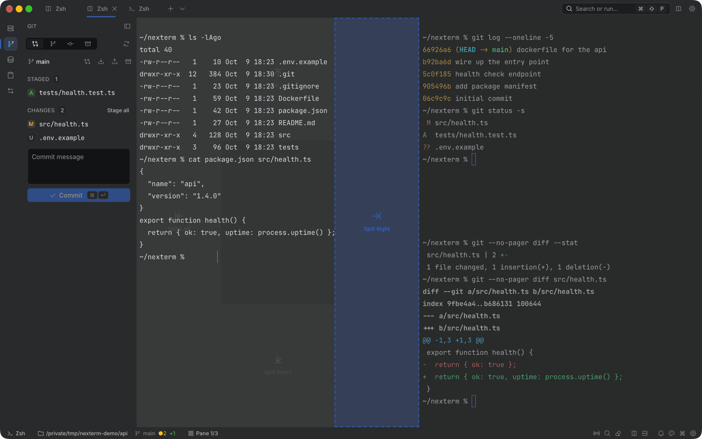</td>
    <td width="50%">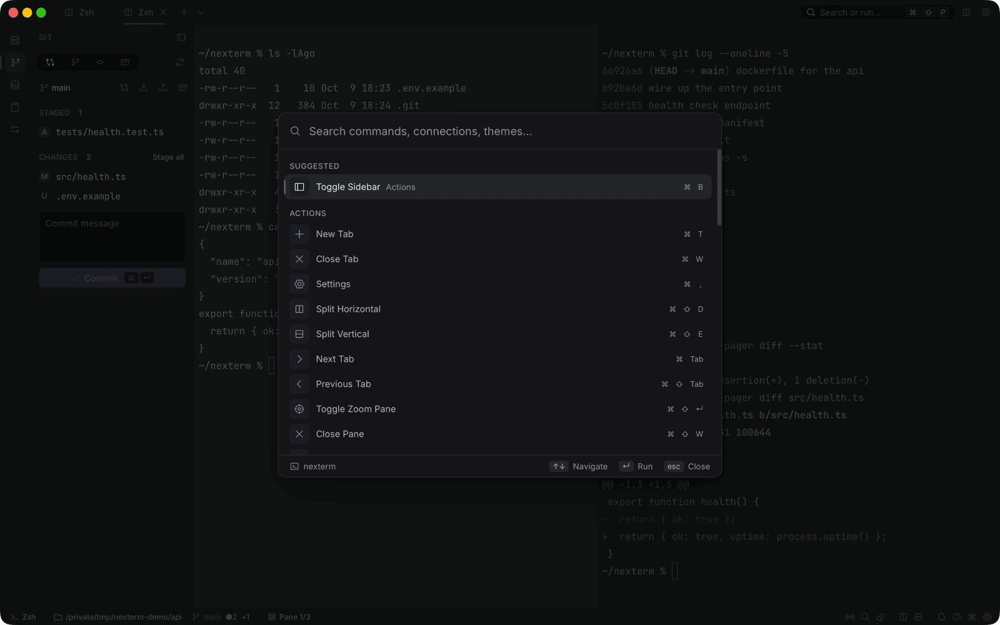</td>
  </tr>
  <tr>
    <td align="center"><sub>drag a tab onto a pane to split it</sub></td>
    <td align="center"><sub>the command palette</sub></td>
  </tr>
  <tr>
    <td>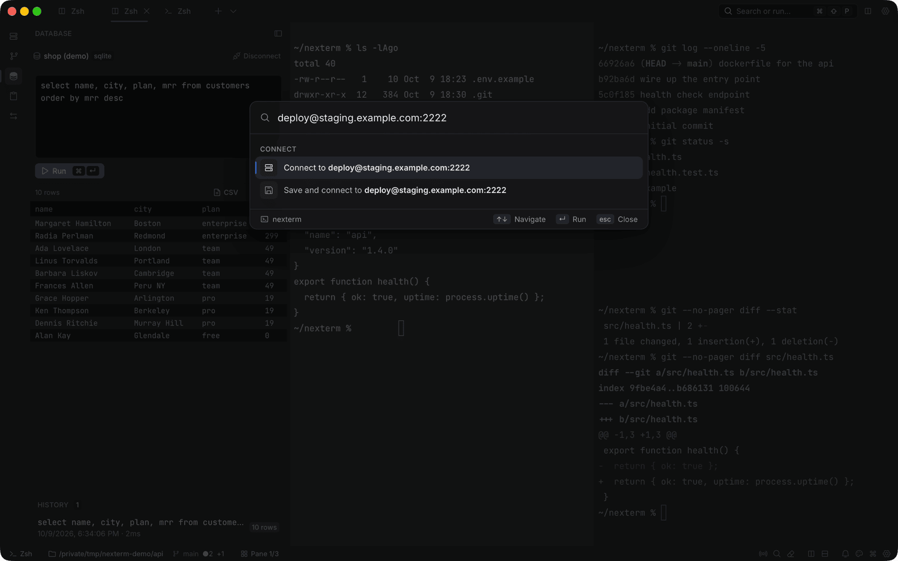</td>
    <td>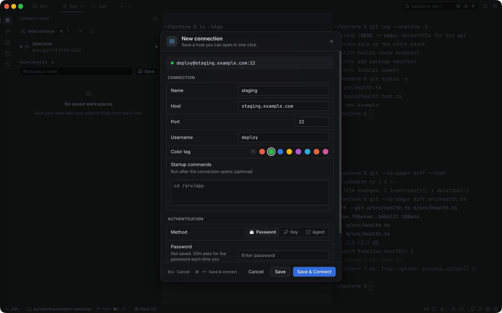</td>
  </tr>
  <tr>
    <td align="center"><sub>quick connect from the palette</sub></td>
    <td align="center"><sub>saving a connection</sub></td>
  </tr>
  <tr>
    <td>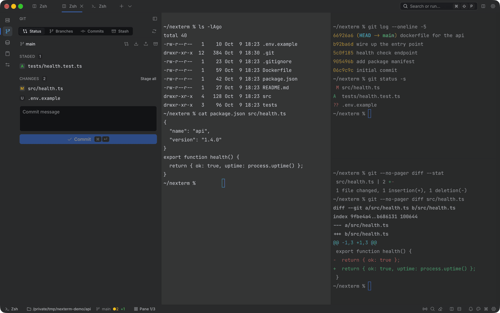</td>
    <td>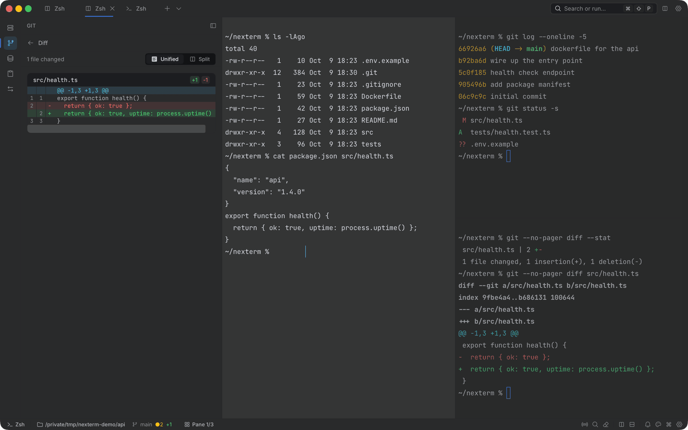</td>
  </tr>
  <tr>
    <td align="center"><sub>git changes and commit box</sub></td>
    <td align="center"><sub>the diff viewer</sub></td>
  </tr>
  <tr>
    <td>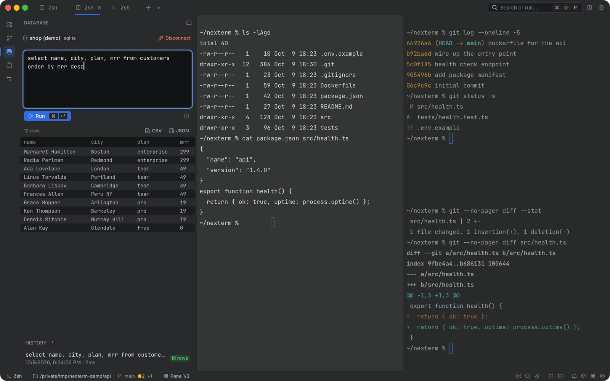</td>
    <td>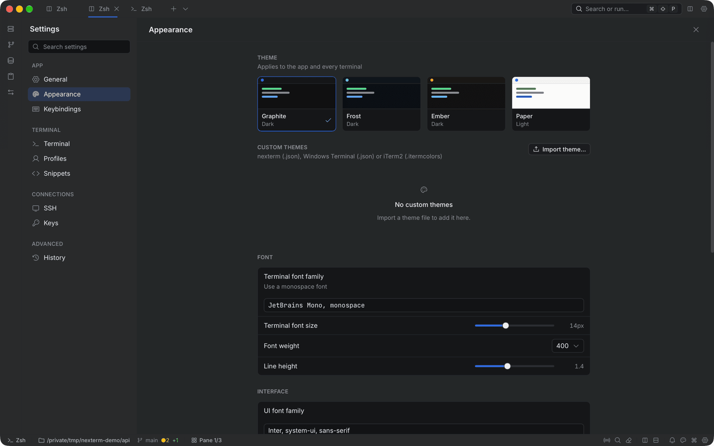</td>
  </tr>
  <tr>
    <td align="center"><sub>querying a sqlite file</sub></td>
    <td align="center"><sub>settings, appearance</sub></td>
  </tr>
</table>

### the four themes

<table>
  <tr>
    <td width="50%">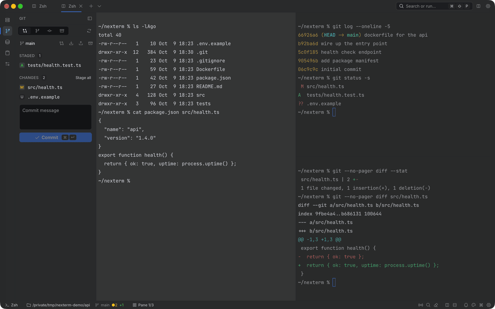</td>
    <td width="50%">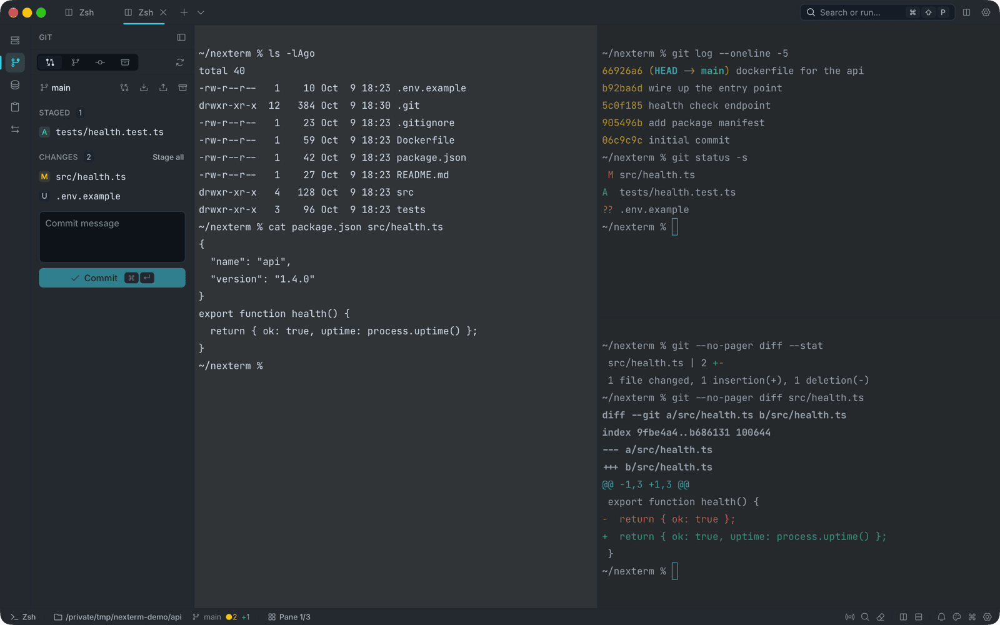</td>
  </tr>
  <tr>
    <td align="center"><sub>graphite (default)</sub></td>
    <td align="center"><sub>frost</sub></td>
  </tr>
  <tr>
    <td>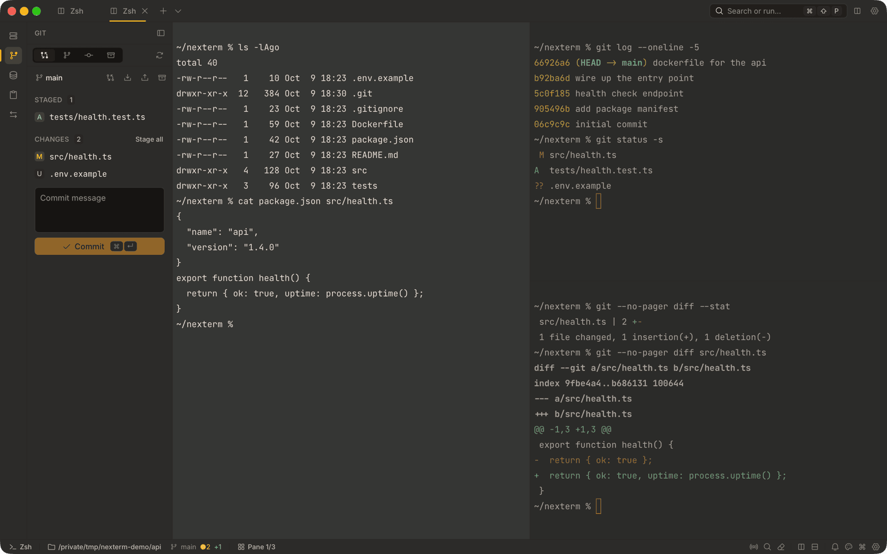</td>
    <td>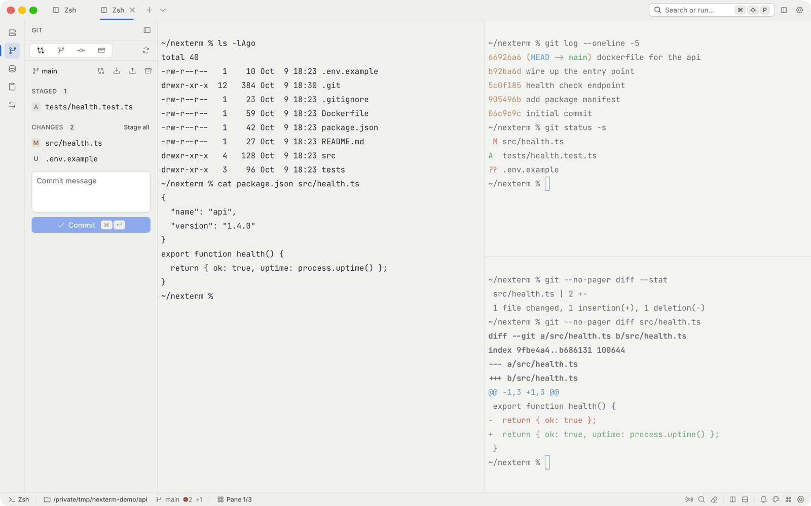</td>
  </tr>
  <tr>
    <td align="center"><sub>ember</sub></td>
    <td align="center"><sub>paper, the light one</sub></td>
  </tr>
</table>

## install

grab the latest build for your os from the [releases page](https://github.com/k6w/nexterm-terminal-app/releases/latest):

| os | file |
|---|---|
| macos (apple silicon) | `Nexterm_<version>_aarch64.dmg` |
| macos (intel) | `Nexterm_<version>_x64.dmg` |
| windows | `.msi`, or the `-setup.exe` installer |
| linux | `.AppImage`, `.deb` or `.rpm` |

the macos builds aren't notarized yet, so the first launch needs a right click on the app and then **open**. after that, nexterm updates itself.

there's no homebrew tap or other package manager listing yet.

## keyboard shortcuts

on windows and linux, read `⌘` as `ctrl`.

| action | macos | windows / linux |
|---|---|---|
| command palette | `⌘⇧P` | `ctrl+shift+p` |
| new tab | `⌘T` | `ctrl+t` |
| close tab | `⌘W` | `ctrl+w` |
| next / previous tab | `⌘⇥` / `⌘⇧⇥` | `ctrl+tab` / `ctrl+shift+tab` |
| go to tab 1 to 9 | `⌘1` … `⌘9` | `ctrl+1` … `ctrl+9` |
| split side by side | `⌘⇧D` | `ctrl+shift+d` |
| split top and bottom | `⌘⇧E` | `ctrl+shift+e` |
| close pane | `⌘⇧W` | `ctrl+shift+w` |
| zoom pane | `⌘⇧↩` | `ctrl+shift+enter` |
| move pane to its own tab | `⌘⇧T` | `ctrl+shift+t` |
| focus next / previous pane | `⌥]` / `⌥[` | `alt+]` / `alt+[` |
| find in terminal | `⌘F` | `ctrl+f` |
| clipboard history | `⌘⇧V` | `ctrl+shift+v` |
| scratchpad | `` ⌥` `` | `` alt+` `` |
| toggle sidebar | `⌘B` | `ctrl+b` |
| settings | `⌘,` | `ctrl+,` |

copy and paste in the terminal are `ctrl+shift+c` and `ctrl+shift+v` on windows and linux. on macos the usual `⌘C` and `⌘V` work. you can rebind any of these in settings, keybindings.

## themes

nexterm ships four themes: graphite (the default), frost, ember and paper. each one covers both the app and the terminal palette, and each passes wcag aa contrast, which a test enforces.

you can also bring your own. go to settings, appearance, **import theme…** and pick a file. nexterm reads its own `.json` format, windows terminal color schemes (`.json`) and iterm2 `.itermcolors`. the easiest way to write one is to copy `src/themes/graphite.json` (or `paper.json` for a light theme), change the `id` and `name`, and edit the colors. [THEMES.md](THEMES.md) lists every token and the rules a theme has to follow.

## build from source

you'll need:

- [node](https://nodejs.org/) 22 (what ci uses)
- [rust](https://rustup.rs/) stable
- the [tauri prerequisites](https://v2.tauri.app/start/prerequisites/) for your os. on macos that's the xcode command line tools, on windows the msvc build tools and webview2. on debian or ubuntu:

```bash
sudo apt-get install -y libwebkit2gtk-4.1-dev libappindicator3-dev librsvg2-dev patchelf libudev-dev pkg-config
```

then:

```bash
npm ci
npm run tauri dev      # run it locally with hot reload
npm run tauri build    # build installers into src-tauri/target/release/bundle
```

checks, the same ones ci runs:

```bash
npm run lint           # eslint plus the lint ratchet
npm run typecheck      # tsc --noEmit
npm test               # vitest

cd src-tauri
cargo clippy -- -D warnings
cargo test
```

## project structure

```
src/                     react front end
├── app/                 app shell, providers, update notice
├── components/          features: terminal, titlebar, sidebar, ssh, sftp,
│                        git, database, command-palette, settings, search,
│                        clipboard, serial, welcome
├── ui/                  the design kit: buttons, dialogs, menus, inputs
├── stores/              zustand state (tabs and panes, settings, theme, ssh…)
├── lib/                 keybindings, ipc wrappers, theme schema, helpers
├── themes/              the four built-in themes as json
└── types/               shared typescript types

src-tauri/src/           rust back end
├── commands/            tauri commands the front end calls
├── pty/                 local shells and cwd tracking
├── sftp/                sftp sessions over russh
├── port_forward/        local, remote and dynamic tunnels
├── known_hosts/         reading and safely rewriting known_hosts
├── ssh_config/          ~/.ssh/config parsing and import
├── db/                  sqlite storage and migrations
├── theme/               native theme bits
├── window/              vibrancy and macos window chrome
└── crypto.rs            at-rest encryption for keys stored in the app
```

## security notes

- **host keys.** before an ssh or sftp session starts, nexterm checks the server key against your own `~/.ssh/known_hosts`. new hosts ask you to trust the fingerprint. a changed key stops the connection and shows both fingerprints. it's only replaced after you type the end of the new fingerprint, and only if the file still holds the key you were shown. a backup of `known_hosts` is written first.
- **ssh passwords are never saved.** there's no column for them. ssh asks each time, or you use a key or your agent.
- **keys stay where they are.** keys picked up from `~/.ssh/config` are stored as a path and read at connect time. if you paste a private key into settings, keys, it's stored in the app database encrypted with aes-gcm. that key is derived from the machine, so treat it as protection against casual reading, not against someone with access to your account.
- **database passwords are saved** in the local app database so the client can reconnect. keep that in mind on shared machines.
- **where things live.** settings, connections, history and scrollback are in `nexterm.db` inside the app data folder (`~/Library/Application Support/com.nexterm.terminal` on macos, `%APPDATA%\com.nexterm.terminal` on windows, `~/.local/share/com.nexterm.terminal` on linux).
- **updates** are signed and checked against a public key built into the app.

## roadmap

- [x] four new themes and a full ui redesign
- [x] lazy-loaded panels for a faster start
- [x] `~/.ssh/config` import and quick connect from the palette
- [x] safe in-place host key replacement
- [ ] full workspace restore, including ssh sessions and panels (in progress)
- [ ] command blocks: each command and its output as its own block (planned)
- [ ] notarized macos builds
- [ ] v0.9.0 release

## contributing

issues and pull requests are welcome. [CONTRIBUTING.md](CONTRIBUTING.md) covers setup, commit style and the checks a pr needs to pass. what changed between versions is in [CHANGELOG.md](CHANGELOG.md).

## license

there's no open source license file in the repo yet, so for now the code is copyright 2026 nexterm, all rights reserved. a license will be added before it's encouraged to fork.
